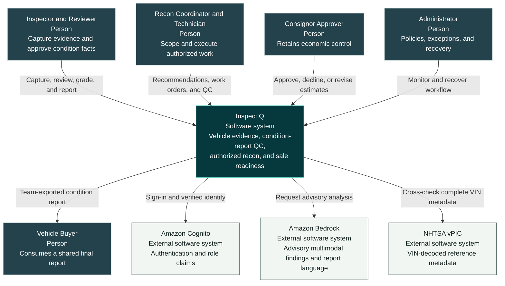
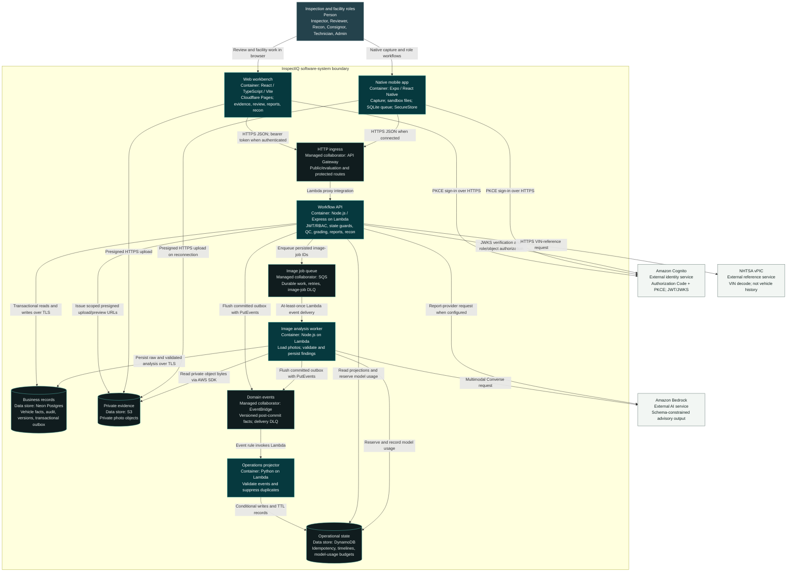

# C4 Architecture: InspectIQ

Scope: the active, **unmerged `agent/inspection-recon-operations` branch**. These views describe its implemented architecture, not features already merged into `main` or a guarantee that every branch revision is deployed. See the [implementation boundary](implementation-boundary.md) and [ADR index](adr/README.md).

The views follow the [C4 system-context](https://c4model.com/diagrams/system-context) and [container](https://c4model.com/diagrams/container) levels. Mermaid is the diagram source so [GitHub can render it inside Markdown](https://docs.github.com/en/get-started/writing-on-github/working-with-advanced-formatting/creating-diagrams). A C4 container is an application or data store, not a requirement to run Docker.

## Level 1: System Context

Audience: a product reviewer, buyer, or engineering interviewer. InspectIQ's responsibility is evidence capture, human-reviewed condition facts, authorization, and release accountability—not a proprietary auction score or an autonomous damage certification.

The buyer receives an export shared by the team; no buyer-login portal is implemented. The no-login Evaluation Workspace is an access mode for inspecting the demo, not an additional authenticated role. Its web review/damage previews are browser-session only and do not modify authoritative records. Partner auction/DMS integration is not shown because generic imports and signed webhooks are not implemented.

## Level 2: Containers

Audience: engineers and operators. The InspectIQ boundary includes clients, server applications, owned data stores, and managed messaging collaborators. Cognito, Bedrock, and vPIC are external service dependencies. Local-only variants are described below rather than mixed into the production-shaped diagram.

### Read the Boundaries

| Boundary | Responsibility and constraint | Source |
| --- | --- | --- |
| Identity and authorization | Cognito issues identity; Lambda verifies JWT/JWKS, roles, and object access. The shared API Gateway route is not itself the Cognito authorizer. | [Auth](../apps/api/src/auth.ts), [RBAC](../apps/api/src/rbac.ts), [production boundary](implementation-boundary.md) |
| Native offline state | Sandbox files and SQLite preserve capture/uploads. They do not grant offline review or release. | [ADR 0011](adr/0011-offline-capture-online-decisions.md), [native sync](../apps/mobile/src/offline/sync.ts) |
| Authoritative records | Postgres owns condition facts, report versions, authorization, audit, and the outbox. Some paths still hydrate a domain-store bridge rather than DB-first aggregate repositories. | [Persistence bridge](../apps/api/src/postgresPersistence.ts), [runtime](../apps/api/src/runtime.ts) |
| Published history | Prior report and evidence records remain immutable. An audited reinspection is a separate fresh-evidence draft linked to the source version; it carries no approvals or spending authority. | [ADR 0014](adr/0014-audited-reinspection-with-immutable-history.md), [reinspection operation](../apps/api/src/store.ts) |
| Image analysis | The API persists job IDs; SQS delivers work; the worker reads S3, calls the provider, validates output, and persists suggestions. Model findings do not directly authorize release. | [Worker](../apps/api/src/imageWorker.ts), [analysis runner](../apps/api/src/imageAnalysisRunner.ts), [ADR 0003](adr/0003-ai-human-review.md) |
| Events vs jobs | API/worker flush a committed outbox; Postgres does not publish directly. EventBridge fans out facts; SQS delivers image work. Duplicate delivery must be safe. | [Outbox delivery](../apps/api/src/awsEvents.ts), [projector](../services/operations-projector/handler.py), [ADR 0009](adr/0009-aws-orchestration-and-vision-services.md) |
| Projection vs truth | DynamoDB owns operational projections/idempotency and model-budget records. It does not own grades, reports, or consignor authorization. | [Operations store](../apps/api/src/operationsStore.ts), [data ownership](architecture.md#data-ownership) |
| Approval and release | Grade, draft language, approved version, recon authorization, work QC, and sale-readiness blockers are separate decisions. | [Workflow](inspection-recon-workflow.md), [state machine](state-machine.md) |

### Optional and Local Variants

- **Grading:** repeatable Node rules run in the API. A configured Python/FastAPI HTTP service can provide the same grading contract; an equivalent Node fallback is retained. It is not a required, separately deployed production container. See [ADR 0005](adr/0005-python-grading-service-boundary.md) and [grading client](../apps/api/src/gradingClient.ts).
- **Development:** deterministic vision/report providers and memory/file persistence keep walkthroughs repeatable without paid model calls. Local actor headers are a development mode, not production authentication. See [ADR 0008](adr/0008-local-ai-provider-for-development.md).
- **Operations:** Secrets Manager, IAM, CloudWatch/X-Ray, alarms, and budgets are cross-cutting deployment controls, omitted from the application diagram for readability. Actual resources are in [Terraform](../infra/terraform/main.tf); the [runbook](runbook.md) covers recovery.
- **Not implemented:** Step Functions orchestration, a dedicated on-device angle classifier, reviewer-editable segmentation regions, a PDF/photo export package, and general auction/DMS connectors. ADR 0010 is a model-development direction, not a deployed detector inventory.

The API mutation path first persists business changes and outbox rows; API/worker delivery then marks event delivery state. Outbox replay and DLQs handle failures. This is not a claim of exactly-once transport or instantaneous projection consistency.

For deployment topology and detailed implementation flow, continue to [runtime architecture](architecture.md), [observability](observability.md), and the [implementation boundary](implementation-boundary.md).
